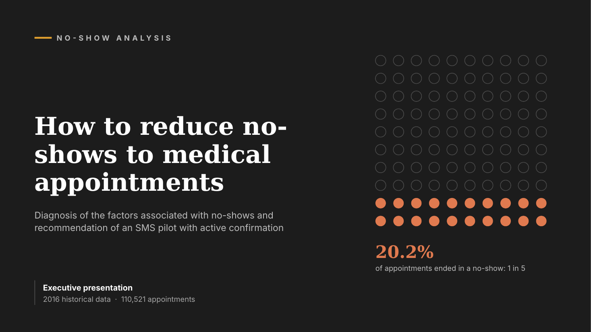
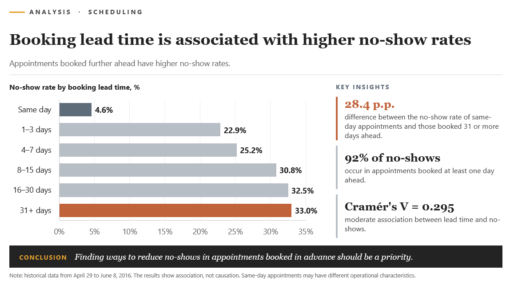
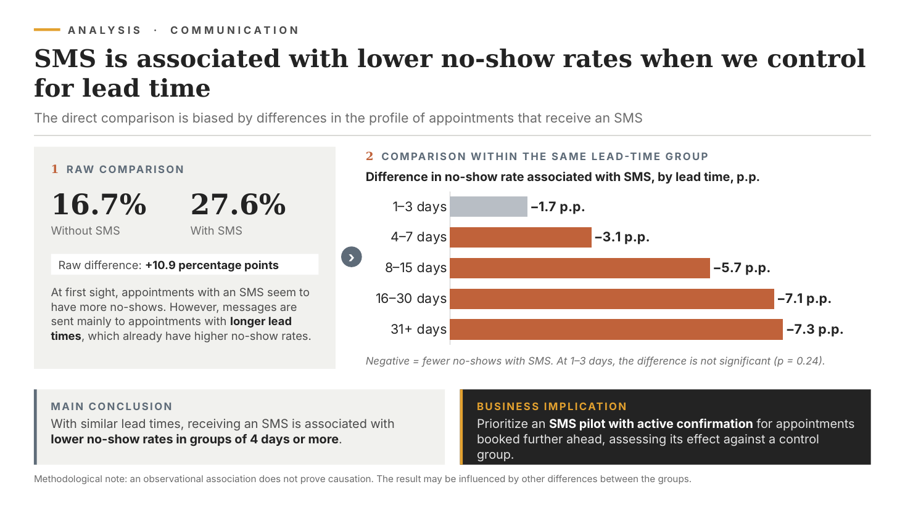
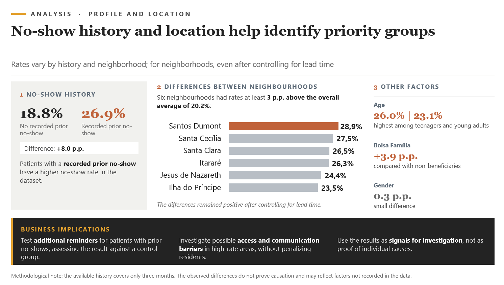
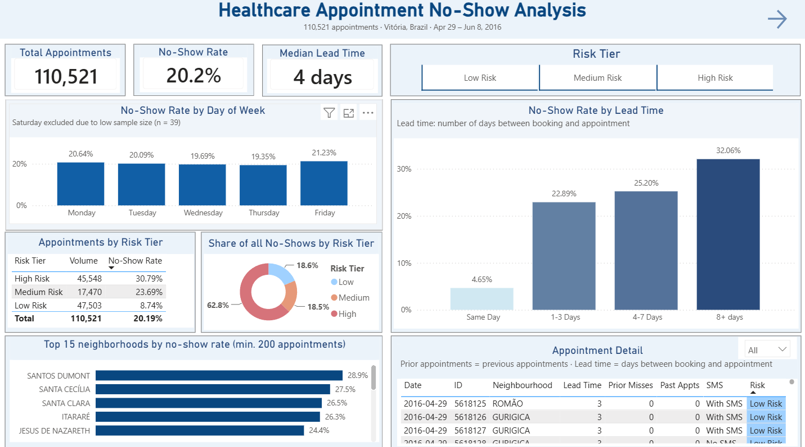
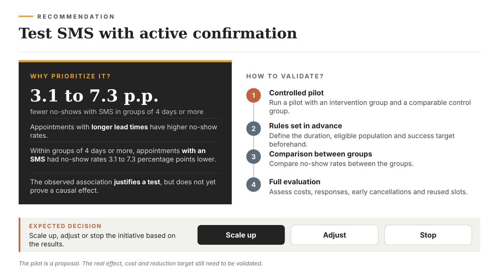

# Healthcare Appointment No-Show Analysis

SQL, Excel and Power BI analysis of 110,521 medical appointments, combining a structured business-problem approach with chi-square hypothesis testing to identify what is associated with missed appointments and which actions to test first.

**[View the interactive Power BI dashboard](https://app.powerbi.com/view?r=eyJrIjoiNGRlYTU5ZTktZDUzMy00OTg0LThhNTktOTYzZmVjMzc5MTAyIiwidCI6Ijk1NDYxM2ZhLWUzN2UtNDZkNi04NGYxLTJmYjNmMzY3MjExMyJ9)** · **[View the executive presentation (PDF)](presentation/no_show_executive_presentation_EN.pdf)**


## Key Findings

- **1 in 5 appointments ends in a no-show (20.2%)**, not the 30% cited in the Kaggle dataset description.
- **Lead time is the dominant factor.** The no-show rate rises from **4.6%** for same-day appointments to **33.0%** for appointments booked 31+ days ahead (Cramér's V = 0.295). Appointments booked one day or more ahead account for **92% of all no-shows**.
- **SMS reminders show a Simpson's paradox.** In the raw data, patients who received an SMS missed *more* (27.6% vs 16.7%), because SMS is only sent for appointments booked well in advance. Within the same lead-time group, SMS is associated with **3.1 to 7.3 p.p. fewer no-shows**.
- **Past behavior repeats.** Patients with a prior no-show miss 26.9% of the time, against 18.8% for returning patients who never missed.
- **Recommendation:** run a controlled pilot of **SMS with active confirmation** (confirm or cancel) for appointments booked 4+ days ahead, and refill cancelled slots through a waiting list.



## Project Overview

Patient no-shows create idle capacity, longer waiting lists and rework for scheduling teams. This project follows a structured problem-solving method (**DEASA**: Define, Structure, Analyze, Solutions, Present):

1. **Define** the problem with the ACERT framework.
2. **Structure** it into hypotheses (H1–H4): scheduling, communication, patient characteristics and location.
3. **Analyze** the data with MySQL, test each hypothesis with chi-square in Excel and build a Power BI dashboard.
4. **Develop solutions** prioritized by evidence, impact and feasibility.
5. **Present** the results in an executive deck in English, built on the pyramid principle.

## Business Problem

**Central question:** how can we reduce no-shows to medical appointments?

## Dataset

[Medical Appointment No-Shows](https://www.kaggle.com/datasets/joniarroba/noshowappointments) (Kaggle). After cleaning, the analysis included **110,521 appointments**.

| Variable | Description |
| --- | --- |
| PatientId | Patient identifier |
| AppointmentID | Appointment identifier |
| Gender | Patient gender |
| Age | Patient age |
| Neighbourhood | Neighborhood where the patient lives |
| Scholarship | Whether the patient receives a government welfare benefit (low-income families) |
| Hypertension, Diabetes, Alcoholism | Health condition indicators |
| Disability_count | Number of disabilities (0 to 4) |
| SMS_received | Whether an SMS reminder was received |
| ScheduledDay | Date and time the appointment was booked |
| AppointmentDay | Date of the appointment |
| No_show | Whether the patient missed the appointment ("Yes" = missed) |
| lead_time_days | Days between booking and appointment |

## Data Cleaning (MySQL)

- Standardized column names and converted date fields
- Removed invalid ages (−1) and negative lead times
- Created `lead_time_days`, `lead_time_group` (6 groups, for the tests), `lead_band` (4 groups, for the dashboard), `age_group`, `day_name` and `has_disability` (1 if Disability_count > 0)
- In `03_risk_analysis.sql`, used window functions to count each patient's `prior_appointments` and `prior_no_shows` (only appointments **before** the current one, to avoid using future information), then derived `no_show_history` (First visit / Returning, no prior no-show / Prior no-show) and `risk_tier`







## Risk Segmentation (SQL)

A rule-based segmentation in `03_risk_analysis.sql` combines **lead time** and the patient's **prior no-show behavior** to flag appointments that may need extra follow-up. Appointments booked 8+ days ahead are always High Risk; shorter lead times move up a tier when the patient has missed previous appointments.

| Risk tier | Appointments | Share of appointments | No-show rate | Share of all no-shows |
| --- | --- | --- | --- | --- |
| High Risk | 45,548 | 41.2% | 30.8% | 62.8% |
| Medium Risk | 17,470 | 15.8% | 23.7% | 18.5% |
| Low Risk | 47,503 | 43.0% | 8.7% | 18.6% |
| **Total** | **110,521** | **100%** | **20.2%** | **100%** |

**Reading:** the High Risk tier holds 41% of appointments but 63% of all no-shows, so focusing reminders and confirmations on it reaches most of the problem with less effort. Low Risk appointments miss only 8.7% of the time.

This is a rule-based segmentation, not a predictive model, and it was not validated on new data. It was not used as a variable in the hypothesis tests, because it is built from the same variables being tested.

## Power BI Dashboard

- **KPI cards:** total appointments (110,521), no-show rate (20.2%) and median lead time (4 days)
- **No-show rate by day of week**, with Saturday omitted (only 39 appointments)
- **No-show rate by lead time:** same day 4.6%, 1–3 days 22.9%, 4–7 days 25.2%, 8+ days 32.1%
- **Appointments and share of no-shows by risk tier**, with a risk-tier filter
- **Top 15 neighborhoods** by no-show rate
- **Appointment detail table** with lead time, prior appointments, prior no-shows, SMS and risk tier

[](https://app.powerbi.com/view?r=eyJrIjoiNGRlYTU5ZTktZDUzMy00OTg0LThhNTktOTYzZmVjMzc5MTAyIiwidCI6Ijk1NDYxM2ZhLWUzN2UtNDZkNi04NGYxLTJmYjNmMzY3MjExMyJ9)

**[Open the interactive dashboard](https://app.powerbi.com/view?r=eyJrIjoiNGRlYTU5ZTktZDUzMy00OTg0LThhNTktOTYzZmVjMzc5MTAyIiwidCI6Ijk1NDYxM2ZhLWUzN2UtNDZkNi04NGYxLTJmYjNmMzY3MjExMyJ9)** (no login required)

## Recommendations and Action Plan

| Initiative | Priority | Proposed decision |
| --- | --- | --- |
| SMS with active confirmation | 1 | Test through a controlled pilot |
| Refill cancelled slots (waiting list) | 2 | Assess together with the cancellation process |
| Targeted reminder for patients with prior no-shows | 3 | Test with a control group |
| Neighborhood differences | Investigate | Understand access barriers before intervening, without penalizing residents |

Rough sizing: extending SMS to the ~40% of 4+ day appointments without one could avoid about 1,270 no-shows (≈ 5.7% of all no-shows), *if* the observed association were causal. That is why the pilot comes first.



## Limitations

- Observational data: the results show association, not causation.
- Only April 29 to June 8, 2016 (about six weeks); no-show history is truncated at the start of the period.
- No data on reason for missing, distance to the unit, specialty, or when and how SMS messages were sent.

## Tools

- **MySQL:** data cleaning, transformation, window functions and risk segmentation
- **Excel:** pivot tables and chi-square tests
- **Power BI:** dashboard
- **PowerPoint:** problem structuring (ACERT) and executive presentation
- **GitHub:** documentation and version control

## Project Structure

```
healthcare-appointment-no-show-analysis/
│
├── README.md
│
├── sql/
│   ├── 01_data_cleaning.sql
│   ├── 02_exploratory_analysis.sql
│   └── 03_risk_analysis.sql
│
├── excel/
│   └── chi_square_tests.xlsx
│
├── powerbi/
│   └── healthcare_no_show_dashboard.pbix
│
├── presentation/
│   ├── no_show_executive_presentation_EN.pdf
│   └── no_show_executive_presentation_EN.pptx
│
└── assets/
    ├── 01–05 presentation slides (.png)
    └── dashboard_preview.png
